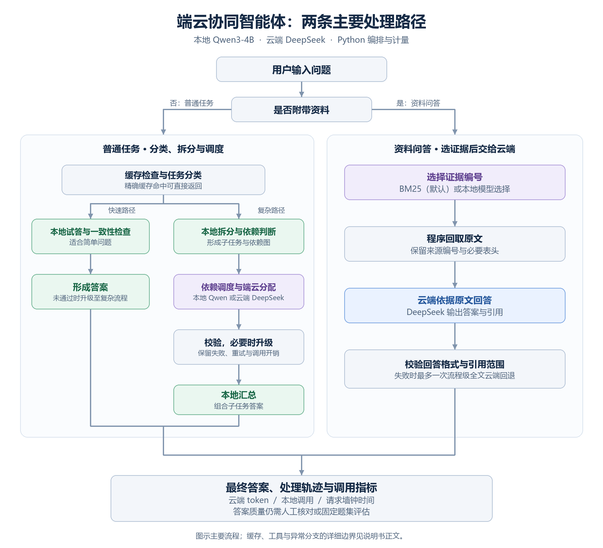

# 代码目录与调用链

本图说明当前统一版本的工程入口，帮助组员在同一套代码上协作。目录整理通过明确职责、入口与文档完成，保留现有导入路径和运行行为。

## 从哪里读起

1. `dot_agent/server.py`：网页静态资源、`GET /api/runtime`、`GET /api/history`、`POST /api/run`。
2. `dot_agent/pipeline.py`：`AgentPipeline.run()`，区分普通任务与资料任务。
3. `dot_agent/orchestrator/evidence.py`：资料校验、检索/编号选择、原文回取、引用契约与回退。
4. `dot_agent/gateway/factory.py`：根据配置选择真实或模拟客户端，执行严格预检。
5. `dot_agent/gateway/metered.py`、`meter.py`、`store.py`：调用、重试与请求级计量。
6. `dot_agent/web/app.js`：请求构造和答案、图、来源、轨迹的渲染。

## 目录职责

| 目录/文件 | 用途 | 修改示例 |
|---|---|---|
| `dot_agent/types.py` | 公共类型与结果结构 | 增加接口字段时核对序列化与前端 |
| `dot_agent/classifier/` | L1/L2 分类与策略协调 | 调整分类规则、提示词或采纳条件 |
| `config/classify_rules.json` | 外置分类规则 | 修改工具词、规划词等 |
| `dot_agent/orchestrator/decomposer.py` | 子任务拆分 | 子任务格式与拆分提示 |
| `dot_agent/orchestrator/scheduler.py` | 依赖图和拓扑层 | 检查依赖、保守退化、并发调度 |
| `dot_agent/orchestrator/signals.py` | 本地试答和一致性等信号 | 采样次数与信号消融 |
| `dot_agent/orchestrator/router.py` | 策略表与端云分配 | 路由规则、阈值 |
| `dot_agent/orchestrator/verify.py` | 输出与约束检查 | 避免把非空当成答案正确 |
| `dot_agent/orchestrator/escalator.py` | 有限升级 | 升级次数与条件 |
| `dot_agent/orchestrator/tools.py` | 计算器、mock 天气与提醒 | 工具边界与失败处理 |
| `dot_agent/orchestrator/evidence.py` | 资料问答 | BM25、来源依赖、回答契约和回退 |
| `dot_agent/gateway/` | 后端协议、预热与计量 | 切换供应商、检查 usage 和失败 |
| `dot_agent/cache/semantic.py` | 当前精确匹配与 TTL | 缓存隔离、失效和后续检索扩展 |
| `dot_agent/web/` | 页面结构、交互和样式 | 输入、结果、依赖图、时间线 |
| `eval/runner.py` | 通用任务对照 | 评分、四模式与报告 |
| `eval/evidence_runner.py` | 资料四路线诊断 | 失败保留、轮换顺序、模拟不评分 |
| `tests/` | 离线回归 | 给真实边界增加反例，不依赖外部模型 |
| `baselines/edge_cloud_prototype/` | 固定提交导入的独立原型 | 用于追溯和基线；不是日常开发入口 |

## 两条主调用链

普通任务大致为：精确缓存 → 分类 → 快速试答，或拆分 → 依赖判断 → 调度/路由 → 校验/升级 → 本地汇总。

资料任务为：验证 sources → BM25 或本地模型选择编号 → 回取原文及依赖表头 → 云端回答 → 检查格式和引用，必要时一次全文回退。它绕过普通拆分和旧问题缓存。

## 接口与计量的改动约束

- `/api/run` 的普通请求 `{"query":"问题"}` 继续有效；资料请求增加 `sources` 与 `selector`。
- 在线 selector 为 `bm25/local`；评测另外提供 `full/rule`。
- `provided_sources` 与 `citations` 分别表示提交来源与实际引用，不能互相替代。
- 模型调用保持通过现有计量装饰器；未知 usage 不估算为 0。
- 调用级 `calls` 和请求级 `tasks` 是不同量纲，不能按 calls 计算请求 P95。
- 账本失败必须显式暴露；不能通过再发模型请求掩盖写账故障。

## 本机多个目录的关系

项目负责人电脑上的 `team-dot-agent/`、`科研执行/team-dot-agent-unified/` 和 `科研执行/team-dot-agent-phase1/` 是同一 Git 仓库的不同工作树；根工作目录本身不是仓库。

组员 clone 本分支后只需面对一个普通的 `dot-agent/` 目录，无需复刻这些工作树，也无需把申请书、论文材料或完整实验档案放进代码仓库。

当前共享版本以统一工作树为来源；科研工作树中的评分和执行器修复没有被整体合并，不能默认共享版具有科研版所有修复。已知边界见 [本次交付说明](RELEASE_20261025.md)。
